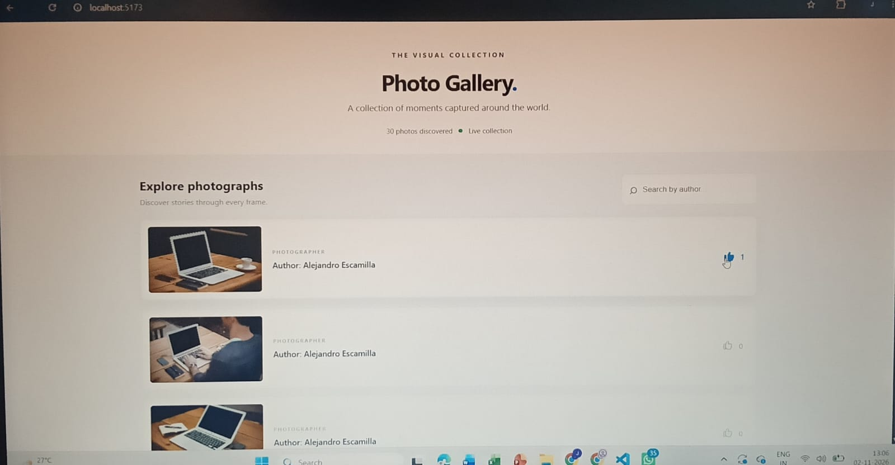

Exactspace UI Assignments

This repository contains two ReactJS assignments completed as part of the Exactspace UI Assignment.

Projects

1. Photo Gallery

A responsive photo gallery application built using ReactJS.

Features:

- Fetches photos from the Lorem Picsum API.
- Displays photos with their respective authors.
- Like and unlike functionality with individual like counts.
- Search photos by author.
- Loads additional photos as the user scrolls.

### Application preview

Technologies: ReactJS, Vite, JavaScript, CSS, Font Awesome, Picsum API.

2. Chat App

A modern chat interface built using ReactJS.

Features:

- Interactive chat interface with multiple randomly assigned usernames.
- Send messages using the input box.
- Displays message authors and timestamps.
- Like and unlike individual messages.
- Searchable emoji picker.
- @ mention functionality.
- Enter to send messages and Shift + Enter for a new line.

Technologies: ReactJS, Vite, JavaScript, CSS.

How to Run the Projects

Make sure Node.js and npm are installed.

Photo Gallery

cd photo-gallery
npm install
npm run dev

Chat App

cd chat-app
npm install
npm run dev

Open the local URL displayed in your terminal to view each application.

Repository Structure

Exactspace-UI-Assignment/
├── photo-gallery/
├── chat-app/
└── README.md

Author

Jyoti Prakash Tasildar
